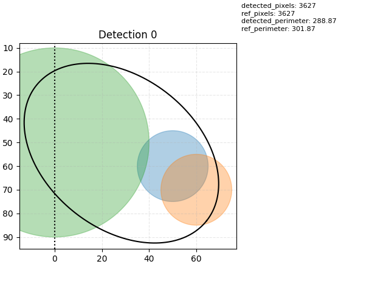
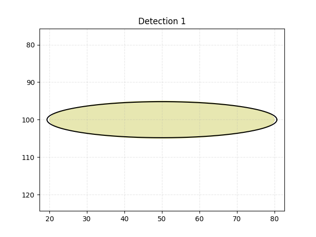
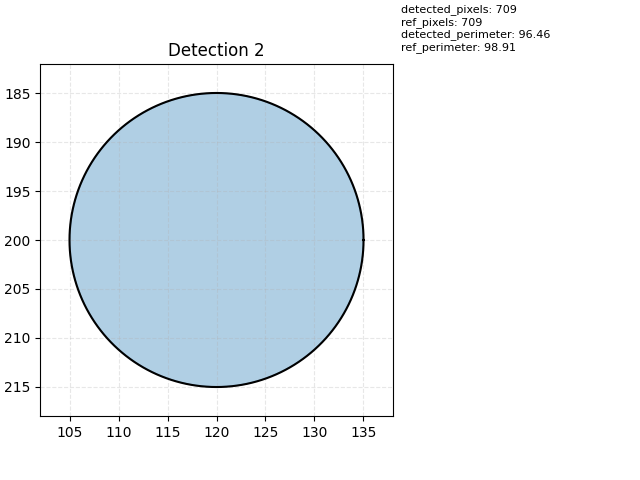
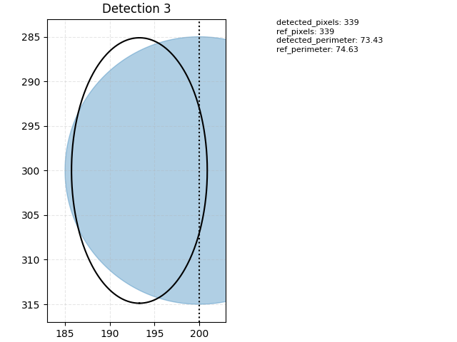
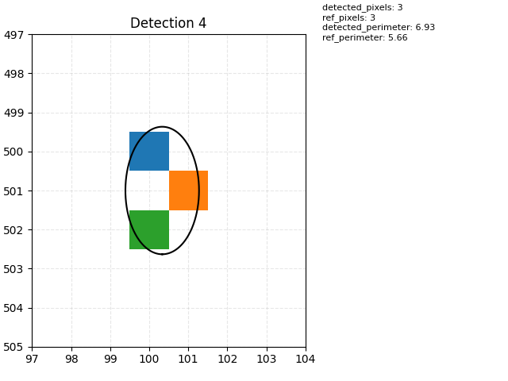

# Cocotb Simulation

This folder contains a cocotb runner, a minimal testbench, and Docker tooling for running the design with GHDL or NVC.

## Quick Run

GHDL (default, Docker if GHDL is not available locally):

```bash
./run_ghdl_docker.sh
```

NVC (Docker):

```bash
./run_nvc_docker.sh
```

## Shapes

Shapes are defined in `sim/cocotb/shapes/` and added in `sim/cocotb/test_linkruncca.py`:

```python
from shapes.Circle import Circle
from shapes.Ellipse import Ellipse
from shapes.Line import Line
from shapes.PixelShape import PixelShape

shapes = [
    Circle(cx=50.0, cy=60.0, r=15.0),
    Ellipse(cx=50.0, cy=100.0, rx=30.0, ry=25.0),
    Line(x0=0.0, y0=199.0, x1=30.0, y1=230.0, width=3.0),
    PixelShape(x=100, y=500),
]
```

Shapes are written to `sim/cocotb/sim_build/results/shapes.json`, and detections are written to `sim/cocotb/sim_build/results/detections.json`.

## Build Images

Build both containers:

```bash
./build_docker.sh
```

Build GHDL container:

```bash
docker-compose -f docker/docker-compose.yml build ghdl-cocotb
```

Build NVC container:

```bash
docker-compose -f docker/docker-compose.yml build nvc-cocotb
```

## Debug (VS Code)

1) Run with debug enabled:

```bash
COCOTB_DEBUG=1 bash run_ghdl_docker.sh
```

NVC debug:

```bash
COCOTB_DEBUG=1 bash run_nvc_docker.sh
```

2) Attach VS Code using the "Attach cocotb (debugpy)" config in `.vscode/launch.json`.

Notes:
- The Docker flow maps port 5678; `run_ghdl_docker.sh` uses `--service-ports` so the port is visible.
- If you change Dockerfiles or dependencies, rebuild the image before running.

## Environment Variables

- `COCOTB_DEBUG`: any non-empty value to wait for debugger
- `GHDL_STD`, `GHDL_BUILD_ARGS`, `GHDL_RUN_ARGS`
- `NVC_STD`, `NVC_BUILD_ARGS`, `NVC_RUN_ARGS`
- `TOPLEVEL`, `COCOTB_TEST_MODULES`/`TEST_MODULE`
- `LINKRUNCCA_PKG`, `LINKRUNCCA_IMWIDTH`, `LINKRUNCCA_IMHEIGHT`

## GUI Plots

Plots are shown by `runner.py` after the simulation completes. To display GUI windows from Docker:

1) Allow local X11 connections:

```bash
xhost +local:
```

2) Run the simulation:

```bash
./run_nvc_docker.sh
```

3) Revoke access when done:

```bash
xhost -local:
```

Notes:
- The run scripts set `DISPLAY`, mount `/tmp/.X11-unix`, and set `MPLBACKEND=TkAgg`.
- To disable plot windows, run with `DISABLE_PLOT=1`, for example:

```bash
DISABLE_PLOT=1 ./run_nvc_docker.sh
```

## Notes

- GHDL VPI does not expose VHDL record ports; use NVC or add a wrapper with flat ports for cocotb access.

## Example Results






